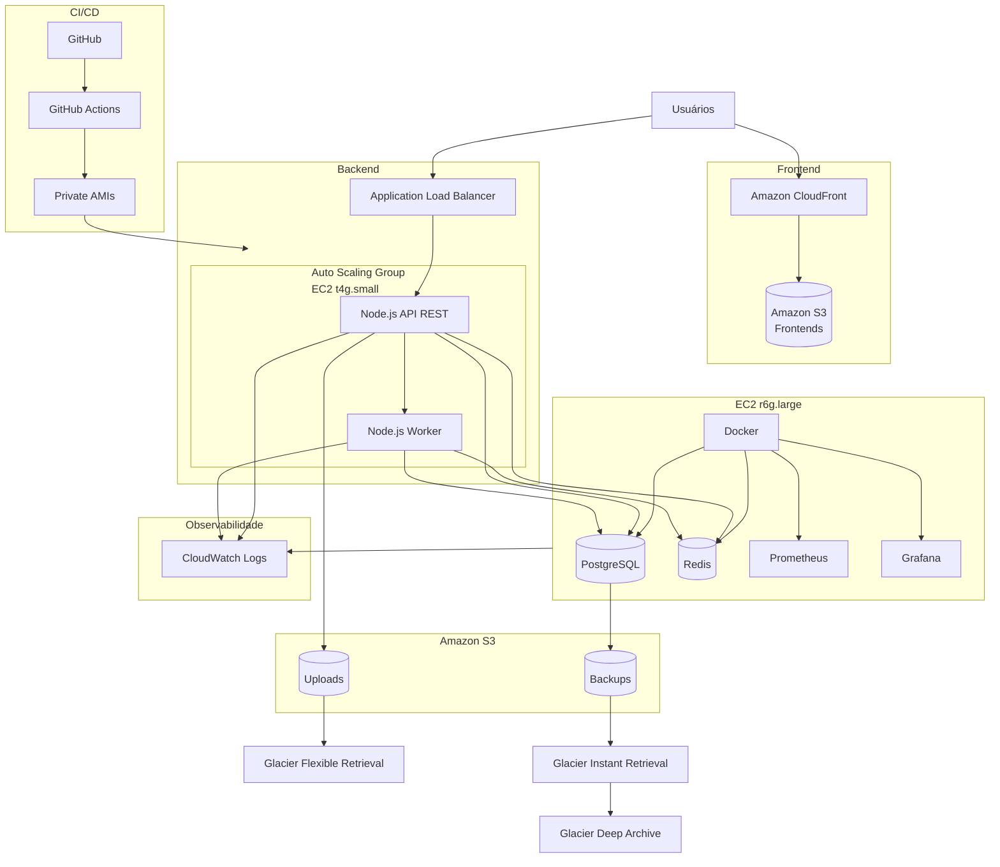

# Arquitetura AWS

## Visão Geral

A plataforma é composta por frontends estáticos, uma API REST, workers assíncronos, serviços de dados, observabilidade e armazenamento.



## Componentes

### Frontends

- Amazon S3 para hospedagem.
- Amazon CloudFront para distribuição.

### API e Workers

- Application Load Balancer.
- Um único Auto Scaling Group.
- Instâncias EC2 `t4g.small`.
- Cada instância executa dois processos/containerizados Node.js:
  - API REST.
  - Worker de filas.
- O ALB encaminha apenas o tráfego HTTP para a API.
- Os workers consomem as filas diretamente.

### Dados e Serviços Compartilhados

Instância EC2 `r6g.large` contendo:

- Docker.
- PostgreSQL.
- Redis.
- Prometheus.
- Grafana.

Os dados persistentes ficam em volumes EBS apropriados para cada serviço.

### Armazenamento S3

Os buckets possuem responsabilidades separadas:

- **Frontend:** arquivos estáticos dos frontends.
- **Uploads:** arquivos enviados pelos usuários.
- **Backups:** dumps do PostgreSQL.

### CI/CD

- Código-fonte e configurações em GitHub.
- GitHub Actions para build, testes, publicação e deploy.
- AMIs privadas utilizadas como imagem base das instâncias EC2.

### Observabilidade

- Prometheus para métricas.
- Grafana para dashboards.
- CloudWatch Logs para logs das instâncias, API e workers.

## Uploads

1. O frontend solicita uma Presigned URL à API.
2. A API gera a URL pré-assinada.
3. O frontend envia o arquivo diretamente ao bucket de uploads.
4. Os objetos permanecem em S3 Standard e são movidos para Glacier Flexible Retrieval após 60 dias.

## Backups

### PostgreSQL

Dumps periódicos são enviados ao bucket de backups.

Lifecycle do bucket:

1. Glacier Instant Retrieval.
2. Glacier Deep Archive.
3. Exclusão conforme a política de retenção.

### EBS

Snapshots dos volumes persistentes são gerenciados pelo AWS Data Lifecycle Manager (DLM). Não existe EBS dedicado para armazenar snapshots.

## Critérios de Escala

API e worker compartilham a mesma capacidade computacional. O Auto Scaling Group adiciona ou remove instâncias conforme a carga observada no conjunto.

### Scale Out

Uma nova instância pode ser adicionada quando qualquer métrica de scaling atingir seu alvo ou indicar necessidade de capacidade.

Principais métricas:

| Métrica | Uso | Fonte |
|---|---|---|
| `ALBRequestCountPerTarget` | Volume de requisições HTTP por instância | CloudWatch / ALB |
| `CPUUtilization` | Saturação de CPU | CloudWatch / EC2 |
| `MemoryUtilization` | Saturação de memória | CloudWatch Agent |
| `QueueDepthPerInstance` | Acúmulo de jobs por instância | Métrica customizada |
| `EventLoopUtilization` | Saturação do event loop do Node.js | Métrica customizada |

### Scale In

A redução do ASG ocorre quando as métricas de scaling permanecem abaixo dos respectivos alvos e existe capacidade suficiente para atender a carga atual.

Quando múltiplas políticas de target tracking são utilizadas, o Auto Scaling prioriza disponibilidade: faz scale out quando qualquer política solicita aumento e scale in somente quando as políticas habilitadas para scale in permitem a redução. citeturn308584search0

### Métricas da API

- `ALBRequestCountPerTarget` como indicador de throughput.
- CPU e memória como indicadores de utilização da instância.
- Latência p95/p99 para monitoramento da experiência da API.
- `EventLoopUtilization` para identificar saturação específica do runtime Node.js.

`ALBRequestCountPerTarget` é uma métrica predefinida para target tracking do EC2 Auto Scaling. citeturn308584search0

### Métricas do Worker

- Quantidade de jobs aguardando.
- Jobs por segundo.
- Idade do job mais antigo.
- Tempo médio de processamento.
- CPU e memória.

Para o ASG, a métrica principal é a quantidade de jobs pendentes normalizada pela quantidade de instâncias, por exemplo:

```text
QueueDepthPerInstance = JobsPending / ASGDesiredCapacity
```

Essa métrica pode ser publicada no CloudWatch como métrica customizada.

## Snapshots EBS

O AWS Data Lifecycle Manager automatiza a criação, retenção e exclusão de snapshots dos volumes EBS. citeturn308584search1turn308584search9

## Instâncias

| Componente | Infraestrutura |
|---|---|
| Frontends | S3 + CloudFront |
| API + Worker | ALB + ASG + EC2 `t4g.small` |
| PostgreSQL | EC2 `r6g.large` + EBS |
| Redis | EC2 `r6g.large` + EBS |
| Prometheus | EC2 `r6g.large` |
| Grafana | EC2 `r6g.large` |
| Logs | CloudWatch Logs |
| Backups | S3 |
| Snapshots EBS | AWS DLM |
| CI/CD | GitHub + GitHub Actions |
